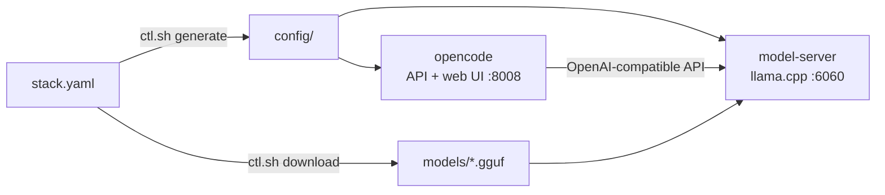

# Bob

Bob is a self-improving AI system powered by the OpenCode 2 coding agent,
running against local models served by llama.cpp.



## Quick start

Edit only `stack.yaml`, then:

```bash
./ctl.sh download    # fetch model files (skips files that already exist)
./ctl.sh build       # build the OpenCode agent image
./ctl.sh start       # regenerate configs, start model-server + opencode
```

All day-to-day operations go through `ctl.sh`; it can be run from any
directory. `./ctl.sh help` lists every command.

| Command | Purpose |
|---------|---------|
| `generate` | Write `config/config.generated.ini` and `config/opencode/opencode.json` from `stack.yaml` |
| `download [--verify] [--force] [--only NAME]` | Fetch model files from Hugging Face |
| `status [--verify]` | Show which model files are present (and compare sizes with Hugging Face) |
| `build` | Build the OpenCode agent image |
| `start [compose args]` | Run `generate`, then start services (default: `model-server opencode`) |
| `stop [service...]` | Stop services |
| `logs [service]` | Tail logs (default: `model-server`) |
| `opencode` | Open the terminal UI, attached to the running opencode server |

The host needs Docker with the compose plugin, plus `python3` with `pyyaml`
for `generate`, `download` and `status`.

## Using the agent

- **Web UI** — <http://localhost:8008> once `./ctl.sh start` is up.
- **Terminal UI** — `./ctl.sh opencode` attaches to the same server, so both
  share sessions.
- **Password** — the server is password-protected. Set `OPENCODE_PASSWORD` in
  `.env`, or use the one generated on first start in
  `config/opencode/server-password`. HTTP clients use Basic auth with username
  `opencode`.
- **Workspace** — the agent works on this repository by default. Set
  `BOB_WORKSPACE=/path/to/project` in `.env` to mount another directory.
- **Without models** — `./ctl.sh start --no-deps opencode` starts only the
  agent and web UI; nothing is downloaded or loaded.

## Network exposure

Ports 6060 (model-server, no auth) and 8008 (OpenCode) are published on
`127.0.0.1` only. The opencode container mounts the host Docker socket, so
anyone who can use the web UI can control the host's Docker daemon. Set
`BOB_BIND=0.0.0.0` in `.env` only on a network you trust.

## Repository layout

```
bob/
├── ctl.sh                   # control surface — start here
├── stack.yaml               # single source of truth (models + opencode agent)
├── .env.example             # optional settings: HF_TOKEN, OPENCODE_PASSWORD, BOB_BIND, BOB_WORKSPACE
├── scripts/                 # one script per ctl.sh command + bootstrap.py (generator/downloader)
├── docker/
│   ├── opencode.Dockerfile        # agent image: OpenCode 2 + small utilities
│   ├── opencode-entrypoint.sh     # docker group, password, drop to non-root `agent`
│   └── model-downloader.Dockerfile
├── docker-compose.yaml
├── config/                  # generated + runtime state (gitignored)
│   ├── config.generated.ini       # model-server preset
│   ├── opencode/                  # opencode.json, server-password
│   └── opencode-data/             # OpenCode sessions and state
├── models/<model-dir>/*.gguf      # downloaded weights (gitignored)
└── AGENTS.md                # rules and gotchas for agent sessions
```

## Services

| Service | Profile | Role |
|---------|---------|------|
| `model-server` | default | llama.cpp server; reads the generated preset; loads one model at a time |
| `opencode` | `opencode` | OpenCode 2 (`@opencode/cli`, pinned by `OPENCODE_VERSION` in `docker/opencode.Dockerfile`); `opencode serve` hosts the API and web UI |
| `model-downloader` | `download` | One-shot sidecar alternative to running `./ctl.sh download` on the host |

The agent image is `node:24-trixie-slim` with git, gh, ripgrep, jq, curl, tmux
and similar small utilities, plus the Docker CLI. Compilers and infra tooling
(kubectl, terraform, ansible, ...) are intentionally not installed; the tool
list lives in the comments of `docker/opencode.Dockerfile`.

## Configuring OpenCode

`./ctl.sh generate` writes `opencode.json` in the native OpenCode 2 format from
the `opencode:` and `models:` sections of `stack.yaml`:

- every model becomes an entry of one OpenAI-compatible provider, with its
  context limit, image input and reasoning settings;
- `opencode.permissions` and `opencode.mcp_servers` are copied through verbatim
  (no MCP servers are configured by default).

Do not edit `config/opencode/opencode.json` by hand; `start` regenerates it.
