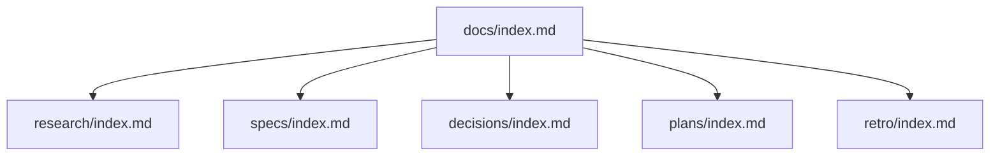

# Bob Documentation System Index

This file is the single entrypoint for the `docs/` system.  

## Purpose

The docs system is designed for agent-maintained continuity across sessions:

- Preserve architecture knowledge, decisions, and execution history.
- Surface task-relevant instructions near the area where work happens.
- Keep context lean by reading only the minimum required documents.

## Lifecycle Areas

| Area | Location | What it contains | Read this first |
|------|----------|------------------|-----------------|
| Research | `docs/research/` | Source-backed findings and hypotheses | `docs/research/index.md` |
| Specs | `docs/specs/` | Requirements, interfaces, and success criteria | `docs/specs/index.md` |
| Decisions | `docs/decisions/` | Architecture decisions and rationale | `docs/decisions/index.md` |
| Design | `docs/design/` | Solution-level architecture design | area index/README when present |
| Plans | `docs/plans/` | Execution plans linked to specs | `docs/plans/index.md` |
| Retro | `docs/retro/` | Lessons learned and process improvements | `docs/retro/index.md` |

## Ingestion Protocol (Surgical Context)

Use this read order to avoid context bloat:

1. Read this file (`docs/index.md`) for system-level navigation.
2. Read exactly one area index based on task type (`specs`, `plans`, etc.).
3. Read only linked documents that are required for the current task.
4. Stop once acceptance criteria, dependencies, and constraints are clear.
5. Update only impacted index rows/links after changing area documents.

## Governance Rules

- Keep `index.md` authoritative in every docs area.
- Keep aliases short and link to the canonical index.
- Preserve traceability with stable IDs (`RES`, `DEC`, `PLAN`, `RETRO`).
- Add references between lifecycle stages (research -> specs -> plans -> retro).
- Prefer mermaid for all new or updated diagrams.

## Structure Map

## Quick Start

1. Understand system behavior via `docs/specs/index.md`.
2. Review existing rationale in `docs/decisions/index.md` (and linked entries).
3. Pick or create a plan in `docs/plans/index.md`.
4. Capture outcomes in `docs/retro/index.md` after execution.
