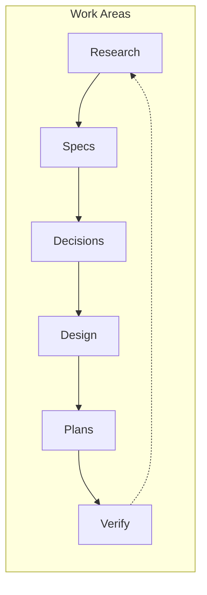
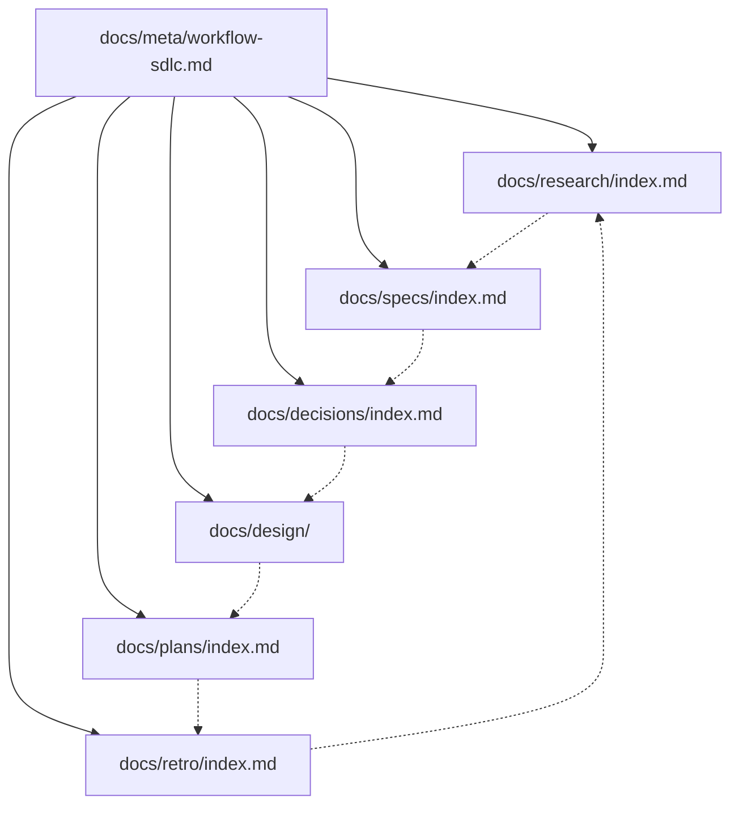

# Software Development Lifecycle (SDLC) Workflow

This workflow documents the end-to-end process for developing software within this project. It describes the lifecycle stages, their integration, and procedural guidance for navigating them effectively.

## Overview

The SDLC follows a structured progression through six lifecycle areas, each serving a distinct purpose and producing artifacts that feed into subsequent stages. This workflow ensures systematic, traceable, and high-quality development.

### Lifecycle Stages

Each stage has its own lifecycle (defined in area-specific docs) but collectively they form the SDLC meta-workflow.

---

## Detailed Workflow

### Stage 1: Research

**Purpose:** Build and preserve knowledge about concepts, the codebase, and how components fit together.

**Why:** Before building anything, you need a grounded mental model. Research prevents reinventing solutions, uncovers hidden requirements, and ensures new work aligns with existing architecture. It also creates a searchable knowledge base that new team members can consult. Without research, specs risk being disconnected from reality, decisions lack context, and designs may introduce avoidable technical debt.

**Entry point:** `docs/research/index.md`

**How it works:**
- Gather context before any work begins (PRINCIPLES: "Build context first")
- Create research entries for new evidence-gathering work
- Keep each entry scoped to one topic or spec cluster
- Number sequentially and update index in same change
- Use consistent citation style and durable source links
- Link findings to specific specs or decision records
- Update status as work moves from `ongoing` → `completed`/`archived`

**Integration:**
- Research informs specs (what needs to be built)
- Research informs decisions (by providing context)
- Research is updated by retrospectives after work completes

**Outputs:** Research entries (`docs/research/RESXXX.md`) linked in `docs/research/index.md`

---

### Stage 2: Specs

**Purpose:** Define *what* needs to be built by specifying requirements, interfaces, and success criteria.

**Why:** Specs translate abstract needs into concrete, verifiable outcomes. By writing specs *before* implementation, you force clarity about boundaries, interfaces, and trade-offs. They prevent scope creep by defining done-ness upfront, and they make code reviews more objective (does the implementation match the spec, or the reverse?). Specs also serve as living contracts between design and implementation, and they make it harder to silently change behavior mid-development.

**Entry point:** `docs/specs/index.md`

**How it works:**
- Each spec defines a component or feature
- Specs include clear success criteria (measurable thresholds)
- Specs reference relevant research findings
- Specs define interfaces that design will implement

**Integration:**
- Specs are informed by research (context from RESXXX)
- Specs inform decisions (what to build) and plans (how to build)
- Specs are updated by retrospectives when requirements change

**Outputs:** Spec documents in `docs/specs/` with IDs (e.g., `SPEC001.md`)

---

### Stage 3: Decisions

**Purpose:** Record architectural decisions made during development, capturing context, trade-offs, and rationale.

**Why:** Without explicit decision records, architecture becomes a mystery maintained only by tribal knowledge. Decisions prevent "it worked so we kept it" patterns that accumulate technical debt. They provide audit trails for *why* things are done a certain way, making it faster to explain systems to newcomers and easier to course-correct when conditions change. Decisions also surface trade-offs that might not otherwise be obvious, helping avoid repeating them elsewhere.

**Entry point:** `docs/decisions/index.md`

**How it works:**
- Each decision is a separate file with format: ID, Title, Context, Options Considered, Decision Made, Rationale, Consequences, References
- File naming: `DECXXX.md` (zero-padded numeric IDs)
- Decisions reference specs they address
- Decisions are updated when context changes or new options emerge

**Integration:**
- Decisions are informed by research and specs
- Decisions inform design (how to implement)
- Decisions are referenced by plans and updated by retrospectives

**Outputs:** Decision records (`docs/decisions/DECXXX.md`)

---

### Stage 4: Design

**Purpose:** Determine *how* to build something by locking in architecture and tech stack.

**Why:** Decisions without design are unimplemented ideas. Design bridges the gap between *what* and *how*, ensuring the implementation actually solves the problem identified in specs. Locking in architecture early prevents the costly pattern of hacking together a solution, then refactoring to something better. Design also documents the implementation approach *before* code is written, making code reviews faster and more targeted. It serves as the blueprint that turns specs into working software.

**Entry point:** `docs/design/` (area index/README when present)

**How it works:**
- Designs are created based on specs and decisions
- Lock in architecture choices (not just implementation details)
- Specify tech stack with justification
- Include success criteria for design validation

**Integration:**
- Design is informed by research, specs, and decisions
- Design informs plans (implementation steps)
- Design is updated by retrospectives when architectural assumptions change

**Outputs:** Design documents in `docs/design/`

---

### Stage 5: Plans

**Purpose:** Plan and coordinate implementation work, breaking down complex tasks into manageable steps.

**Why:** Plans translate design into executable actions. They ensure implementation is reproducible and verifiable, not just ad-hoc experimentation. Decomposing work into steps with clear prerequisites prevents missing dependencies and makes progress visible and measurable. Plans also document the "how" in a way that survives team changes—if a person leaves, the plan explains the approach. They make it possible to coordinate multiple people or machines working on the same goal without stepping on each other.

**Entry point:** `docs/plans/index.md`

**How it works:**
- Plans decompose specs into implementation steps with prerequisites
- Design a direct acyclic dependency graph as Mermaid diagram in plan file
- No arbitrary estimates; use reproducible verification criteria
- Consider existing behavior when planning changes
- Always include success criteria and verification steps

**Integration:**
- Plans reference research, specs, decisions, and design
- Plans are executed during implementation
- Plans are updated by retrospectives when scope or approach changes

**Outputs:** Plan documents (`docs/plans/PLANXXX.md`) with dependency graphs

---

### Stage 6: Verify (and Retro)

**Purpose:** Ensure each change is validated and documented. Verification happens throughout; retrospectives conclude work.

**Why:** Verification is the final gate—without it, everything else is just theory. Automated verification (tests, CI) ensures the change works as specified and doesn't break other parts of the system. Measurable success criteria prevent vague notions of "it works" and make regression detection reliable. Retrospectives close the loop by feeding lessons back into earlier stages, preventing repeated mistakes. They transform individual experience into organizational memory, ensuring that the system as a whole keeps improving rather than just accumulating code.

**Entry point:** `docs/retro/index.md`

**How it works (Verification):**
- Each change includes reproducible automated verification steps (tests, CI checks)
- Each change has measurable success criteria (performance thresholds, behavior checks)
- A task is only "done" when verified and compared to linked documents for gaps
- Gaps must be flagged, documented, and surfaced to the human operator

**How it works (Retrospective):**
- On conclusion of work: summarize Achievements, list Impediments and Pitfalls, document learnings
- Link corresponding plan
- Retrospectives feed back into decisions, research, and specs

**Integration:**
- Verification happens at each lifecycle stage (research verification, spec verification, etc.)
- Retrospectives update all earlier stages as needed
- Verification ensures traceability to specs and decisions

**Outputs:** Verification results (tests, CI passes) and retrospective records (`docs/retro/RETROXXX.md`)

---

## Cross-Cutting Principles

The SDLC workflow is guided by core principles that apply across all stages:

### Maintain a mental model
Keep a mental model of how and why parts of the system relate to each other. The graph representation helps to understand and traverse complex systems efficiently.

### Maintain consistency
Keep documentation and implementation consistent. Always update documentation before implementation. Review all affected artifacts again after implementation and align them.

### Mermaid diagrams
All diagrams in markdown files must be Mermaid.

### Verification as completion
A task is only considered done when it has been verified and implementation scope compared to linked documents to check for gaps. Gaps must be flagged, documented and surfaced to the human operator.

---

## Navigation Guide

### For new work:
1. Start with research if you need context (`docs/research/index.md`)
2. Write specs defining requirements (`docs/specs/index.md`)
3. Make decisions about implementation (`docs/decisions/index.md`)
4. Design the solution (`docs/design/`)
5. Plan the work (`docs/plans/index.md`)
6. Verify and retrospect (`docs/retro/index.md`)

### For existing areas:
- Each area index contains its own lifecycle (how to work within that stage)
- Refer back to `docs/meta/workflow-sdlc.md` when you need to understand cross-stage integration or overall process

### When something is unclear:
- Check the corresponding index for domain-specific guidance
- Check this workflow file for cross-stage context
- Look at linked decisions and research for background

---

## Structure Map

This diagram shows the SDLC meta-workflow (solid arrows) and the cross-stage influence (dashed arrows).
