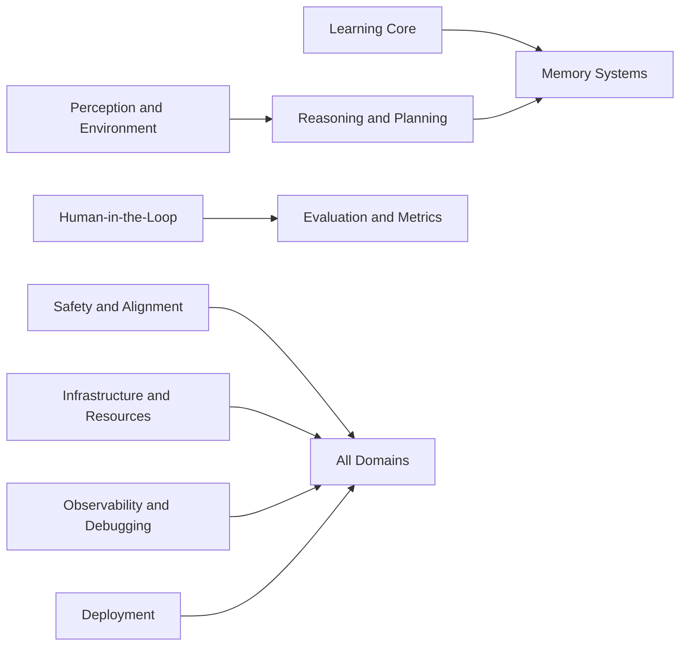

# Bob System Specifications Index

Canonical index for the Bob specification area.

## Scope

This area defines what must be built: component requirements, interfaces, data
contracts, success criteria, and open questions for the Bob system.

## Quick Navigation

| Domain | Location | Specs |
|--------|----------|-------|
| Learning Core | [learning/](./learning/README.md) | 4 specs |
| Memory Systems | [memory/](./memory/README.md) | 3 specs |
| Reasoning & Planning | [reasoning/](./reasoning/README.md) | 4 specs |
| Perception & Environment | [perception/](./perception/README.md) | 3 specs |
| Human-in-the-Loop | [human-loop/](./human-loop/README.md) | 3 specs |
| Evaluation & Metrics | [evaluation/](./evaluation/README.md) | 3 specs |
| Safety & Alignment | [safety/](./safety/README.md) | 4 specs |
| Infrastructure & Resources | [infrastructure/](./infrastructure/README.md) | 3 specs |
| Observability & Debugging | [observability/](./observability/README.md) | 3 specs |
| Deployment Considerations | [deployment/](./deployment/README.md) | 3 specs |

**Total specifications:** 34

## Task-Driven Ingestion

1. Read this file for domain map and contribution rules.
2. Open the target domain README and only the specs needed for the task.
3. Follow links to related `decisions`, `plans`, and `research` only when needed.
4. Update this index when adding/removing specs or changing ownership.

## Architecture Overview



## Cross-Spec Dependencies

- **Memory systems:** episodic, semantic, and procedural memory are foundational.
- **Knowledge base:** every domain references semantic/episodic/procedural state.
- **Evaluation & metrics:** shared performance and self-evaluation loops.
- **Infrastructure:** shared compute, data, and storage constraints.
- **Observability:** shared logging, monitoring, and debugging visibility.

## Working with Specs

### For Readers

1. Understand the big picture in this index.
2. Find your domain and read domain overview.
3. Read requirements, interfaces, and success criteria.
4. Follow cross-references only for directly impacted dependencies.

### For Contributors

1. Write/update spec content before implementation work.
2. Keep specs technology-agnostic unless a decision requires specificity.
3. Link related specs and lifecycle docs using relative markdown links.
4. Update this index and verify links after changes.

### For Project Managers

1. Use domain map to identify dependency coupling.
2. Plan parallel/spec review sequencing from cross-dependencies.
3. Track progress by domain coverage and acceptance criteria closure.

## Specification Format

Each spec file should include:

1. **Overview** - what the component does and why it matters.
2. **Requirements** - functional and non-functional requirements.
3. **Interfaces** - APIs, data contracts, and external dependencies.
4. **Success criteria** - measurable acceptance criteria.
5. **Open questions** - unresolved design/implementation questions.
6. **References** - citations, research, and related docs.

Template:

```markdown
# [Component] Specification

## Overview
[What does this component do and why it matters]

## Requirements
- [ ] Requirement 1
- [ ] Requirement 2

## Interfaces
### External Interfaces
[API/Interface definition]

### Internal Interfaces
[Internal interface definition]

## Data Contracts
### Schema 1
[Data schema definition]

## Success Criteria
1. Metric 1: Target value
2. Metric 2: Target value

## Open Questions
1. Question 1?

## References
- [Citation 1]
```

## Specification Inventory

### Learning Core (4)

| Name | File | Key Topics |
|---|---|---|
| Self-Supervised Learning | `learning/self-supervised.md` | contrastive learning, embeddings, curriculum learning |
| Reinforcement Learning | `learning/reinforcement.md` | rewards, exploration, policy optimization, RLHF |
| Online/Incremental Learning | `learning/online-learning.md` | continual learning, replay, PEFT, active learning |
| Transfer Learning | `learning/transfer-learning.md` | adaptation, multi-task, few-shot, distillation |

### Memory Systems (3)

| Name | File | Key Topics |
|---|---|---|
| Episodic Memory | `memory/episodic.md` | consolidation, forgetting, temporal indexing |
| Semantic Memory | `memory/semantic.md` | knowledge graphs, ontology, fact verification |
| Procedural Memory | `memory/procedural.md` | skills, heuristics, triggering |

### Reasoning & Planning (4)

| Name | File | Key Topics |
|---|---|---|
| Logical Reasoning | `reasoning/logical.md` | deductive/inductive/abductive reasoning |
| Problem Solving | `reasoning/problem-solving.md` | decomposition, search, constraints |
| Strategic Planning | `reasoning/strategic-planning.md` | horizon management, monitoring |
| Causal Reasoning | `reasoning/causal.md` | counterfactuals, do-calculus, causal discovery |

### Perception & Environment (3)

| Name | File | Key Topics |
|---|---|---|
| Multimodal Input | `perception/multimodal.md` | NLU, vision, audio, fusion |
| Action Generation | `perception/actions.md` | tool calling, API interaction, code generation |
| Environmental Understanding | `perception/environment.md` | state estimation, anomaly detection |

### Human-in-the-Loop (3)

| Name | File | Key Topics |
|---|---|---|
| User Feedback | `human-loop/feedback.md` | preference learning, calibration |
| Communication | `human-loop/communication.md` | dialogue, explanation, collaboration |
| Value Alignment | `human-loop/value-alignment.md` | constitutional alignment, ethics |

### Evaluation & Metrics (3)

| Name | File | Key Topics |
|---|---|---|
| Performance Metrics | `evaluation/performance.md` | quality metrics, robustness tracking |
| Self-Evaluation | `evaluation/self-evaluation.md` | uncertainty, meta-evaluation |
| Benchmarking | `evaluation/benchmarking.md` | suites, regression tests, ablations |

### Safety & Alignment (4)

| Name | File | Key Topics |
|---|---|---|
| Robustness | `safety/robustness.md` | adversarial and OOD resilience |
| Bias Mitigation | `safety/bias.md` | fairness monitoring and mitigation |
| Explainability | `safety/explainability.md` | attribution and decision traces |
| Value Alignment (Safety) | `safety/value-alignment.md` | reward hacking prevention, ethics |

### Infrastructure & Resources (3)

| Name | File | Key Topics |
|---|---|---|
| Compute Management | `infrastructure/compute.md` | serving, allocation, optimization |
| Data Management | `infrastructure/data.md` | collection, privacy, lifecycle |
| Storage Systems | `infrastructure/storage.md` | vector/graph storage, retrieval |

### Observability & Debugging (3)

| Name | File | Key Topics |
|---|---|---|
| Logging | `observability/logging.md` | structured traces, memory snapshots |
| Monitoring | `observability/monitoring.md` | dashboards, anomalies, health |
| Debugging Tools | `observability/debugging.md` | inspection, counterfactual analysis |

### Deployment Considerations (3)

| Name | File | Key Topics |
|---|---|---|
| Scalability | `deployment/scalability.md` | horizontal scaling, load balancing |
| Reliability | `deployment/reliability.md` | fault tolerance, graceful degradation |
| Updates & Versioning | `deployment/updates.md` | release pipelines, rollback, flags |

## Summary Statistics

- **Total specifications:** 34
- **Total domains:** 10
- **Total requirements:** 250+ unique requirements
- **Total open questions:** 100+
- **Total cross-references:** 150+

## Related Documentation

- [`../index.md`](../index.md) - docs system entrypoint
- [`../decisions/index.md`](../decisions/index.md) - architecture decisions
- [`../plans/index.md`](../plans/index.md) - implementation plan index
- [`../research/index.md`](../research/index.md) - research sources and findings
- [`../retro/index.md`](../retro/index.md) - execution learnings
